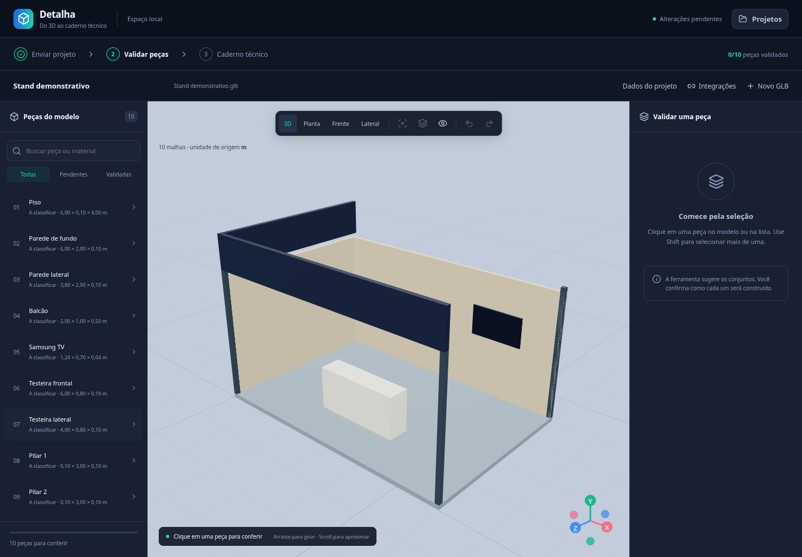
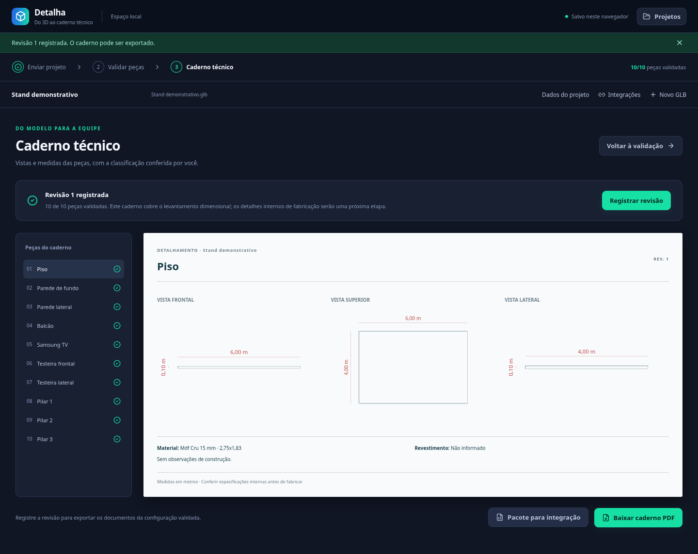

# Detalha — detalhamento técnico de stands

Aplicação independente para transformar um modelo `.glb` em um levantamento organizado de peças, com validação humana, classificação dos materiais e vistas cotadas. Interface e recursos de navegação 3D derivados do Studio, com identidade configurável e sem dependência de seus repositórios em tempo de execução.

## O que já funciona nesta base

- Abertura direta do SketchUp (.skp, versão 2021+) por um leitor próprio, sem extensão nem conversão: grupos, componentes, nomes, tags e materiais; componentes com nome viram uma peça e produtos expostos ficam reunidos. Para o 3ds Max (2023+), um script gera o .glb com grupos, camadas e materiais. Ver [docs/SKETCHUP.md](docs/SKETCHUP.md).
- Upload de GLB 2.0 de até 200 MB, incluindo Draco, Meshopt e KTX2/Basis.
- Abertura direta de DWG, DXF e ZIP (WeTransfer), sem converter para GLB: malhas do SketchUp (MESH, polyface, 3DFACE) e blocos como peças, com a unidade detectada pelo tamanho do desenho. Sólidos do AutoCAD (3DSOLID, BODY, REGION) de arquivos 2013+ são lidos por um leitor próprio do formato ACIS (`src/lib/dwg/acis`): faces planas, cilíndricas, cônicas, esféricas e toroidais. Faces de superfície livre (spline) e sólidos de arquivos anteriores ao AutoCAD 2013 ainda pedem MESHSMOOTH no AutoCAD. No espaço em nuvem o DWG/DXF/ZIP original é enviado ao Storage, com assinatura e SHA-256 conferidos pela função `dt_saveProject`.
- Caderno de arte (comunicação visual, a partir do Arte Guide): escolha as paredes; cada face vira um gabarito A4 com medidas, sangria, área de segurança e interferências detectadas no modelo (TV, prateleira, balcão), com cotas em cadeia. O PDF abre com o mapa de instalação (isométrica com A, B, C…) e traz a vista 3D de cada parede.
- Exportar 3D: peças escolhidas em .glb (metros, Y para cima), ou um .zip com um arquivo por peça.
- Caderno técnico só com as peças validadas: folha A4 por peça com vistas frontal, superior e lateral na mesma escala normalizada, linhas ocultas tracejadas, cotas totais e parciais em mm, raios das partes curvas e perspectiva isométrica de apoio.
- Modo leve automático acima de 50 MB: abre geometria e cores sem decodificar texturas, preservando peças, medidas e o arquivo original.
- Organização inicial por componentes da hierarquia do arquivo. Nomes, materiais visuais e forma ajudam nas sugestões, mas **não confirmam a construção**.
- Seleção pelo 3D ou pela lista, seleção múltipla, isolamento, transparência, foco, navegação e desfazer/refazer.
- Reunião de peças em um conjunto e separação de um conjunto nas malhas que o compõem.
- Validação de tipo, material de construção, revestimento, medidas externas do GLB e observações. Metalon usa as medidas do modelo, sem pedir seção ou espessura do tubo.
- Catálogo inicial com 19 referências técnicas derivadas do orçamento USET, sem preços ou custos.
- Armazenamento no navegador, reabertura de projetos e exportação/restauração dos dados de validação em JSON.
- Registro de revisão após validar todas as peças, pacote técnico JSON e caderno dimensional em PDF.
- Adaptador Firebase com login, espaços de trabalho, reserva de upload, salvamento com controle de concorrência e revisões imutáveis.
- Contratos para associar configuração do Studio e fornecer uma referência ao app de produção. A integração automática permanece desligada até a conexão dos aplicativos.

## Escopo da primeira versão

O caderno contém medidas e vistas da geometria, materiais selecionados e observações. **Não é uma liberação de fabricação ou um cálculo estrutural.** Chapas internas, encaixes, reforços e listas de corte exigem peças modeladas ou padrões construtivos ainda a cadastrar. Esses dados não são inventados a partir do material de renderização.

O particionamento propõe conjuntos e permite corrigir o agrupamento. Não é uma operação CAD que corta um sólido arbitrário: se várias peças de fabricação foram exportadas como uma única malha conectada, será necessário preparar o modelo ou acrescentar um padrão construtivo. Modelos muito detalhados podem ter vistas de envelope simplificadas, identificadas no documento.

## Executar localmente

Requisitos: Node.js 22+ e npm. Java 21 é necessário apenas para os emuladores Firebase.

```bash
npm ci
cp .env.example .env.local
npm run dev
```

O modo padrão é local. Não exige login e não envia o GLB ao servidor. Os arquivos ficam no IndexedDB do navegador. Use **Dados do projeto → Exportar validação** para preservar um JSON e mantenha o GLB original; ambos são necessários para restaurar em outro navegador.

Fluxo: enviar GLB → conferir unidade → selecionar/classificar peças → confirmar medidas e validar → abrir caderno → registrar revisão → baixar PDF/pacote JSON.

Há uma demonstração gerada no navegador, sem arquivos de clientes incorporados ao repositório.

Publicação do frontend no GitHub Pages: [docs/GITHUB_PAGES.md](docs/GITHUB_PAGES.md). O workflow gera a versão com armazenamento no navegador e usa a subpasta do repositório.





## Firebase e implantação

Veja [docs/FIREBASE.md](docs/FIREBASE.md). O segredo `FIREBASE_SERVICE_ACCOUNT`, usado pelo Studio, é suficiente como credencial de publicação quando possuir acesso aos recursos necessários. As chaves web públicas do Firebase são configuradas separadamente; a conta de serviço nunca deve entrar em uma variável `VITE_` ou no bundle.

- Funções: prefixo `dt_`, região `southamerica-east1`, codebase `detalhamento`.
- Dados e GLBs: namespace `dt_workspaces`.
- `firebase.shared.json`: configura apenas o novo Hosting e a codebase. **Não publica regras globais do projeto compartilhado.**
- `firebase.json`: configuração de instalação independente e emuladores.
- `firebase/*.fragment`: trechos para integrar às regras compartilhadas existentes.
- Deploy é manual. Não há publicação automática ao fazer push. Os sites do Studio e da produção não são substituídos.

## Integrações e arquitetura

Leia [docs/ARQUITETURA.md](docs/ARQUITETURA.md) e [docs/INTEGRACOES.md](docs/INTEGRACOES.md). Para vender separadamente, use um Firebase próprio e configuração web própria, altere `VITE_APP_NAME` e deixe a integração Studio desativada. Catálogo, renderizador e domínio continuam dentro deste repositório.

Referências:

- [Studio / personalização](https://github.com/cleitonpn/personalize-stand-forum-.git)
- [App de produção](https://github.com/cleitonpn/produ-o-personalizada.git)
- [Orçamento / materiais](https://github.com/cleitonpn/or-amento-uset.git)
- [Arte Guide](https://github.com/cleitonpn/arte_guide.git)

## Verificação

```bash
npm test
npm run test:server
npm run build
npx playwright install chromium
npm run test:e2e
npm run test:rules
npm run test:backend
```

Os testes cobrem peças coincidentes, dimensões de componentes rotacionados, escala, agrupamento, confirmação humana, invalidação após edição, identidade do GLB, contratos e isolamento de acesso. As regras são verificadas somente em emuladores com projeto `demo-detalhamento`.

Resultados e verificação com o GLB ECBR: [docs/VERIFICACAO.md](docs/VERIFICACAO.md).

Estudo comparativo dos quatro modelos ECBR, SHELL e LOTERIAS: [docs/ESTUDO_GLB.md](docs/ESTUDO_GLB.md).

Requisito e estratégia para raios e detalhamento de testeiras, balcões e paredes curvas: [docs/PECAS_CURVAS.md](docs/PECAS_CURVAS.md). O cálculo de raios ainda não está implementado.

## Próximas entregas

1. Padrões construtivos parametrizados e validados para paredes, testeiras e balcões.
2. Detalhes internos, cortes, ferragens e relação de peças com origem explícita.
3. Associação robusta dos IDs validados do Studio ao GLB final exportado e sincronização das revisões.
4. Consulta dos documentos técnicos dentro do app de produção.
5. Administração de equipes, convites e catálogo próprio por empresa.
