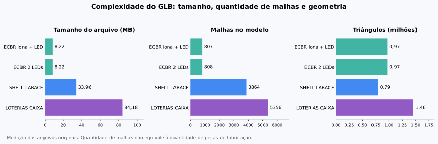

# Estudo dos quatro modelos de referência

Estudo realizado em 10/10/2026 nos arquivos originais fornecidos pelo usuário. Usa o carregador Three.js e os módulos de particionamento e vistas da base `ee005ee`. O diagnóstico não modifica a geometria, o agrupamento ou os limites da aplicação.

## Comparação

| Modelo                  |  Arquivo | Malhas | Triângulos | Materiais visuais | Imagens | Conjuntos iniciais |
| ----------------------- | -------: | -----: | ---------: | ----------------: | ------: | -----------------: |
| ECBR — 1 lona e 1 LED   |  8,22 MB |    807 |    972.386 |                21 |       9 |                 33 |
| ECBR — 2 painéis de LED |  8,22 MB |    808 |    972.394 |                21 |       9 |                 33 |
| SHELL LABACE            | 33,96 MB |  3.864 |    794.129 |                46 |      21 |                 13 |
| LOTERIAS CAIXA          | 84,18 MB |  5.356 |  1.459.174 |             1.712 |   1.664 |                106 |

MB nesta tabela significa 1.000.000 bytes. Na base estudada inicialmente, o limite chamado de “50 MB” na interface era implementado como 50 MiB, ou 52.428.800 bytes. O LOTERIAS excedia esse limite. A ampliação posterior aceita **200 MiB**, exibidos como 200 MB, e abre arquivos acima de 50 MiB em modo leve, sem texturas.



**Os conjuntos iniciais não representam automaticamente peças de fabricação.** A inspeção encontrou agrupamentos que contêm vários objetos e outros que contêm centenas de fragmentos de um objeto só. Quantidade de malhas, tamanho do arquivo e qualidade da organização são fatores diferentes.

Todos os arquivos são GLB 2.0 gerados pelo SimLab GLTF, com imagens incorporadas, sem buffers/imagens externos, animações ou esqueletos. Usam a extensão opcional `KHR_materials_pbrSpecularGlossiness` e também contêm materiais PBR padrão. Não foi encontrada compressão Draco ou Meshopt declarada nesses quatro arquivos.

## ECBR: boa referência para a primeira etapa

Ambas as versões permitem obter os 33 conjuntos pela hierarquia atual. O balcão mede **2,00 × 1,00 × 0,53 m** e há quatro testeiras de **3,00 × 1,00 × 0,03 m**. Essas medidas são envelopes geométricos, sujeitos à conferência; não incluem uma lista inferida de chapas ou perfis internos.

O custo geométrico está concentrado em mobiliário e iluminação: conjuntos cujos nomes identificam banquetas e trilhos somam aproximadamente **98,3% dos triângulos**. As paredes e testeiras exigem bem menos geometria. Isso favorece manter os objetos de referência visíveis no 3D e tratá-los separadamente das peças a fabricar.

Há 23 nomes genéricos entre os 33 conjuntos. As sugestões indicam 8 possíveis testeiras, embora apenas quatro conjuntos tenham a dimensão 3 × 1 × 0,03 m. A heurística também alcança outros painéis altos; seu resultado não deve ser confirmado automaticamente.

Sete conjuntos de mobiliário/iluminação usam envelope simplificado nas três vistas, pelo limite atual de 8.000 arestas por vista. As testeiras e o balcão não pertencem a esse grupo simplificado.

### Diferenças entre as versões

32 conjuntos coincidem pela combinação de dimensões, posição, quantidade de triângulos e materiais. A diferença encontrada é um painel de 1,20 × 2,91 × 0,10 m: uma versão tem uma malha e 12 triângulos; a outra tem duas malhas, 20 triângulos e um material visual adicional. Essa comparação não determina, sozinha, a especificação física de lona ou LED.

Entre os 32 conjuntos correspondentes, apenas **3 mantêm o mesmo ID por caminho da hierarquia**. A ordem dos objetos foi alterada na exportação. Os hashes dos GLBs são diferentes, portanto os vínculos atuais devem continuar restritos ao arquivo a que pertencem.

Para reaproveitar validações, priorizar IDs estáveis exportados pelo Studio. Quando eles não existirem, apresentar correspondências candidatas por geometria, posição, orientação e materiais, destacando ambiguidades para o operador revisar. Não copiar confirmações apenas pela ordem das peças.

## SHELL: o agrupamento exige outra estratégia

O arquivo tem menos triângulos que o ECBR, mas quase cinco vezes mais malhas. O número reduzido de conjuntos detectados esconde um problema: **2.848 malhas estão reunidas em um conjunto chamado `shell-logo-pb-2.dxf`**.

Esse conjunto abrange praticamente o stand inteiro, com envelope de **10,06 × 4,426 × 4,00 m**, 700.534 triângulos e diversos materiais visuais. A sugestão atual o classifica como mobiliário devido a nomes presentes nos materiais/descendentes. Essa sugestão não representa adequadamente o conjunto e não deve ser usada para confirmar sua construção.

Onze outros conjuntos correspondem a pequenos objetos chamados `Enscape.RectangularLight`, cada um com 92 malhas. O nome de um descendente não é suficiente para identificar a função construtiva do seu grupo superior.

É possível analisar e medir o modelo, mas o particionamento atual não oferece uma lista adequada de paredes, balcões, testeiras e estrutura nesse caso. Separar o conjunto principal diretamente em milhares de malhas também não atende ao operador que não é arquiteto.

Próxima estratégia recomendada:

1. Percorrer a hierarquia recursivamente, removendo apenas invólucros sem função geométrica.
2. Exibir níveis intermediários: stand, módulos, conjuntos e peças.
3. Permitir expandir um conjunto em seus componentes diretos, preservando grupos coerentes de mobiliário e equipamentos.
4. Identificar grupos que ocupam grande parte do stand ou misturam módulos distantes, para pedir revisão do agrupamento.
5. Quando a hierarquia for insuficiente, propor agrupamentos por conectividade, proximidade e superfícies coplanares, com validação humana.
6. Definir nomes pelo nível selecionado e contexto geométrico, evitando herdar o primeiro nome encontrado em um grupo grande.

## LOTERIAS: peso das texturas e fragmentação

A leitura geométrica local funcionou; na base inicial, o upload normal era bloqueado pelo tamanho. O arquivo tem **58,92 MB em imagens incorporadas**, aproximadamente **70% do total**. Os dados binários de geometria ocupam cerca de 18,51 MB.

Existem 1.664 imagens, das quais 1.660 têm bytes distintos. Remover apenas duplicatas exatas economizaria aproximadamente **1,44 MB**; isso não bastaria para trazer o arquivo ao antigo limite de 50 MiB. Muitas imagens são pequenas e estreitas, compatíveis com fragmentação por face na exportação. Para visualização com texturas, é necessário avaliar atlas, reexportação e redução de resolução, preservando a aparência e as associações das peças.

Há uma imagem de 4.096 × 8.192 px. Somar todas as imagens como RGBA com mipmaps resulta em uma **estimativa de aproximadamente 1,29 GB**. Isso é uma estimativa de representação de textura, não uma medição de memória real do navegador ou garantia de que todas as imagens sejam residentes simultaneamente. O pico também depende da decodificação, do renderer, do dispositivo e dos materiais utilizados. Todos os materiais/imagens encontrados são referenciados pela geometria.

O modelo permite propor 106 conjuntos, mas ainda há exemplos que exigem subdivisão ou renomeação:

- `Poltrona Julia` contém 1.658 malhas, com apenas 22.526 triângulos: muitos fragmentos pequenos de um mesmo conjunto.
- Dois conjuntos sem nome têm 813 malhas cada, ocupando aproximadamente 0,60 × 0,216 × 0,518 m.
- Conjuntos chamados `TV 65` medem aproximadamente 3,00 × 2,75 × 1,28 m e incluem materiais de madeira. O nome identifica um elemento dentro de um conjunto maior, não as dimensões da TV isolada.

Vinte conjuntos utilizam pelo menos uma vista simplificada; são 59 vistas simplificadas das 318 possíveis. A geometria pode orientar o levantamento, mas essas vistas não descrevem os componentes internos para fabricação.

O suporte a esse porte deve combinar carregamento progressivo, otimização de texturas, redução de chamadas de desenho e preservação dos IDs individuais para seleção. A ampliação do limite alterou frontend, domínio compartilhado, Functions e regras de Storage em conjunto. O modo leve preserva toda a geometria, os nomes, IDs e cores dos materiais, sem decodificar as imagens. Ele evita o custo dessas texturas, mas não reduz polígonos nem garante fluidez em qualquer dispositivo. O GLB original é preservado no armazenamento.

## Medição, identificação e intervenção humana

Foram encontradas 136 transformações espelhadas em cada ECBR, 1.895 no SHELL e 2.475 no LOTERIAS. A geração de vistas precisa preservar orientação e espelhamento; largura, altura e profundidade não bastam para reconstruir a posição de uma peça.

O diagnóstico também encontrou colisões nas chaves auxiliares do Studio: 39 chaves repetidas em cada ECBR, 225 no SHELL e 538 no LOTERIAS. São contagens de valores de chave compartilhados por mais de uma malha. O ID por caminho desta ferramenta diferencia essas malhas no mesmo arquivo. A integração entre versões deve usar IDs persistentes e o hash de origem, com reconciliação das associações.

Os projetos agrupados ocupam aproximadamente 49 kB, 122 kB e 191 kB em JSON, respectivamente. A limitação do LOTERIAS observado é o arquivo, não o tamanho desses metadados. Expandir milhares de malhas em peças individuais aumentaria muito tanto o documento quanto o esforço de validação.

O operador deve confirmar separadamente:

- Qual elemento ou conjunto foi identificado.
- Se ele será fabricado ou apenas usado como equipamento/mobiliário de referência.
- Quais partes são estrutura, parede, revestimento e complementos.
- Material, seção, espessura e padrão construtivo.
- Medidas, orientação, posição e revisão de origem.

Esses GLBs mostram o exterior e a organização visual. Não fornecem, por si só, seções de metalon, reforços, ferragens, encaixes ou regras de corte suficientes para liberar fabricação.

## Prioridades para a próxima implementação

1. **Hierarquia navegável e subdivisão por componentes**, usando o SHELL como caso principal e mantendo os agrupamentos coerentes dos ECBR.
2. **Modo de referência para móveis, iluminação e equipamentos**, preservando-os no 3D e evitando validar sua tesselação como peças a fabricar.
3. **Contornos e medidas de peças curvas**, com raios e desenhos para testeiras, balcões e paredes, conforme [PECAS_CURVAS.md](PECAS_CURVAS.md).
4. **Otimização adicional de modelos grandes**, usando o LOTERIAS como referência para texturas e chamadas de desenho. O limite de 200 MiB e o modo leve já foram implementados.
5. **Identidade e comparação entre revisões**, usando as duas versões ECBR para detectar alterações sem perder vínculos.
6. **Padrões construtivos**, para converter elementos confirmados em peças físicas, cortes e detalhes internos com origem técnica explícita.

## Reproduzir o diagnóstico

```bash
npm ci
node scripts/estudar-glbs.mjs --out-dir /tmp/relatorios-glb '/caminho/modelo.glb'
```

O script lê a geometria sem carregar texturas e usa os mesmos módulos `partitionScene` e `buildDrawing` da aplicação. Registra contagens, grupos, medidas, complexidade das vistas e restrições de tamanho. Seus tempos medem somente o processamento de geometria no Node; não representam a experiência completa no navegador.

Este diagnóstico CLI foi preparado para o corpus recebido, com geometria sem Draco/Meshopt. A aplicação no navegador tem os decodificadores desses formatos; o script não substitui esse carregador completo nem resolve recursos externos.

Na verificação inicial, o ECBR com lona carregou 807 malhas/33 conjuntos; o SHELL carregou 3.864 malhas/13 conjuntos e permitiu selecionar e isolar o conjunto principal. Não foram registrados erros JavaScript nesses cenários. Naquela versão, a interface rejeitou o LOTERIAS com a mensagem de limite de 50 MB; sua geometria foi estudada separadamente. O ECBR com dois LEDs passou pelo teste de navegador descrito em [VERIFICACAO.md](VERIFICACAO.md). O mesmo documento registra os testes posteriores com o limite ampliado e o modo leve.

O Chromium deste ambiente usa WebGL por software. O carregamento até a lista ficar disponível levou aproximadamente 8 s no ECBR com lona e 40 s no SHELL nesta execução; esses valores não são um benchmark de GPU, fluidez de navegação ou garantia de desempenho no computador do usuário.

Os GLBs originais, imagens extraídas e relatórios completos por malha não são incorporados ao repositório. O estudo preserva os arquivos para servir como referências de regressão locais.

Fontes no Drive fornecidas pelo usuário: [ECBR — 2 LEDs](https://drive.google.com/file/d/1o0X4KqZG_ffOrYx00hxiq3EhOU_c0Zn6/view), [LOTERIAS CAIXA](https://drive.google.com/file/d/1U4kQqP3BFje5mX-kfAN3m70zMmN9zToq/view) e [SHELL LABACE](https://drive.google.com/file/d/1g3ozq05DH_NkT-ueoFK8ljTz-2lV4vZy/view). A versão ECBR com lona foi recebida como anexo.
